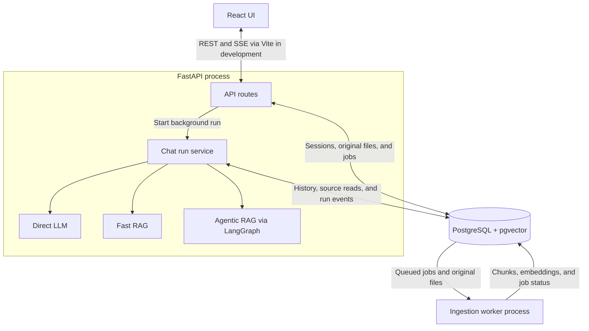

# Agentic RAG

Chat with your documents, inspect the sources behind an answer, and return to saved conversations. The app routes each question to direct generation, fast retrieval, or agentic research.

## Live demo

https://github.com/user-attachments/assets/7f33c246-c636-48b0-90ef-c6e87eea93c5

Follow two real NVIDIA earnings PDFs from upload and indexing to cited chat, deep comparison, source inspection, answer versions, Stop, saved history, and knowledge-base management. The video has visible chapter captions and no audio. Waiting periods are shortened for viewing.

## Quickstart

Requires Python 3.12, `uv`, Node.js 24 with npm 11, and Docker with Compose.

Run these commands from the repository root.

```bash
uv sync --locked --group dev
npm --prefix frontend ci
cp .env.example .env
npm run dev
```

The launcher starts the UI, API, and indexing worker and provisions local PostgreSQL to keep uploads and chats across restarts. Open the [chat at 127.0.0.1:5173](http://127.0.0.1:5173/).

## Using the app

1. Open **Knowledge Bases** in the sidebar, create a base, and upload your documents. Wait for them to be indexed.
2. Choose **Chat with this knowledge base** or select the base in the composer. Turn on **Deep analysis** for a comparison or other multistep task.
3. Select a citation to inspect the source or choose **More → View activity** to see what ran. Use **Stop** to cancel a run and **Regenerate** to create another answer version.

| Chat mode | When to use it |
| --- | --- |
| Direct LLM | General questions and conversational follow-ups |
| Fast RAG | Lookups, summaries, and takeaways from the selected knowledge base |
| Agentic RAG | Complex questions that benefit from planning, tools, and verification |

Upload up to 10 files per batch, each up to 8 MiB. Supported formats are PDF, DOCX, TXT, Markdown, CSV, JSON, and HTML. The knowledge base dashboard supports previews, original downloads, and deletion with the appropriate permissions.

## Configuration

- **Model gateway.** The template uses OpenAI. For another OpenAI-compatible gateway, use its base URL, model IDs, and API key. Embeddings share the chat URL and key unless you set overrides. See [.env.example](.env.example).
- **Existing databases.** To reuse a Compose volume, set `POSTGRES_PASSWORD` to its current password. For a managed database, set `AGENTIC_RAG_DATABASE_URL` to a connection without superuser or `BYPASSRLS` privileges and `AGENTIC_RAG_DATABASE_ADMIN_URL` to the migration connection.
- **Upgrades.** Stop the old API and worker before restarting `npm run dev`. For separately managed services, run `uv run agentic-rag migrate` with both database URLs before restarting.
- **Access.** The demo identity is for loopback development. The local and production profiles use JWT authentication. See [configuration profiles](configs/).

## Checks and evaluation

| Command | What it runs |
| --- | --- |
| `make lint type test` | Python lint, type checks, and tests |
| `npm --prefix frontend test` | Frontend tests |
| `make demo` | Indexes sample documents and compares two refund policies in baseline, advanced, and agentic modes |
| `make eval-demo` | Runs 40 labeled cases and writes results to `reports/demo/` |
| `make build` | Builds the Python package and frontend assets |

The offline demo and evaluation use deterministic providers and synthetic documents. For the optional RAGBench sample, run `make hf`, then `AGENTIC_RAG_STORE=fake make eval-hf` for an in-memory run. The reference score measures similarity to the dataset's generated answers. See the [evaluation dataset guide](datasets/golden/README.md).

For frontend lint, type checks, and browser tests, see the [frontend guide](frontend/README.md).

## Architecture and API

### How requests flow



- **Chat.** Direct LLM answers from conversation context. Fast RAG retrieves authorized passages for lookups or reads a selected document in order for overviews. Agentic RAG uses LangGraph to plan, gather evidence and call tools, synthesize, and verify within a run budget.
- **Indexing.** The API stores original files and queues jobs in PostgreSQL. The worker claims jobs, parses and chunks files, and saves their embeddings. In the demo profile, the upload handler also runs the job processor during the request.

### Main API endpoints

The local API listens on `http://127.0.0.1:8001` by default. In authenticated profiles, send `Authorization: Bearer <JWT>` on protected routes.

| Endpoint | Purpose |
| --- | --- |
| `POST /api/v2/sessions` | Create a conversation and return its ID. |
| `GET /api/v2/sessions/{session_id}` | Load a saved conversation and its messages. |
| `POST /api/v2/runs` | Submit a `question` with optional `session_id`, `kb_ids`, and `mode`. Returns `202 Accepted` with `run_id` and `events_url`. |
| `GET /api/v2/runs/{run_id}/events` | Stream run activity and the terminal result via server-sent events (SSE). Reconnect with `Last-Event-ID` to receive missed events. |
| `GET /api/v2/runs/{run_id}` | Read the run status, answer, and citations. |
| `POST /api/v2/runs/{run_id}/cancel` | Cancel an active run. |
| `POST /api/v2/kb` | Create a knowledge base. |
| `POST /api/v2/kb/{kb_id}/documents` | Upload multipart `files`. Returns `202 Accepted` with an indexing job per file. |
| `GET /api/v2/jobs/{job_id}` | Check indexing status. |
| `GET /api/v2/sources/{evidence_id}` | Read a cited document passage if authorized. |

To save a turn to an existing chat, pass its `session_id` when starting a run, then connect to the returned `events_url`. The default `mode` is `auto`. Explicit modes are `direct`, `baseline`, `advanced`, and `agentic`. For passage lookups, `baseline` uses dense retrieval and `advanced` uses hybrid retrieval with reranking.

See the [interactive API docs](http://127.0.0.1:8001/docs) and [OpenAPI contract](contracts/openapi.json) for the full request and response schemas.

After changing the API, run `make contracts` and `npm --prefix frontend run generate:api-types`.
